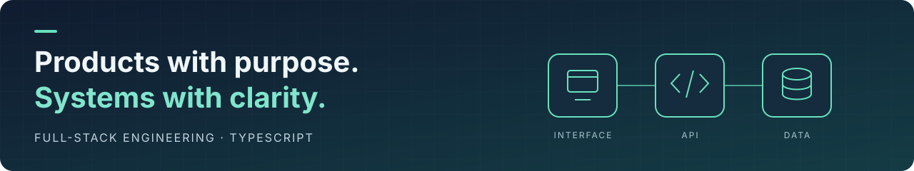
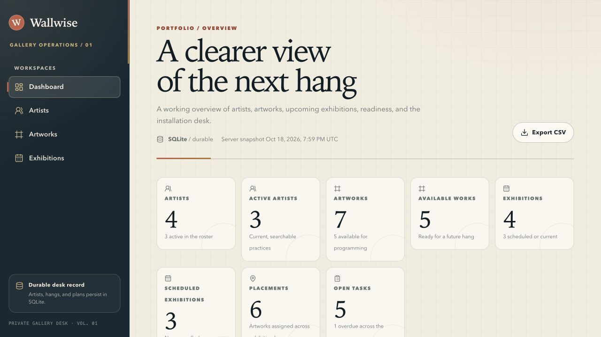
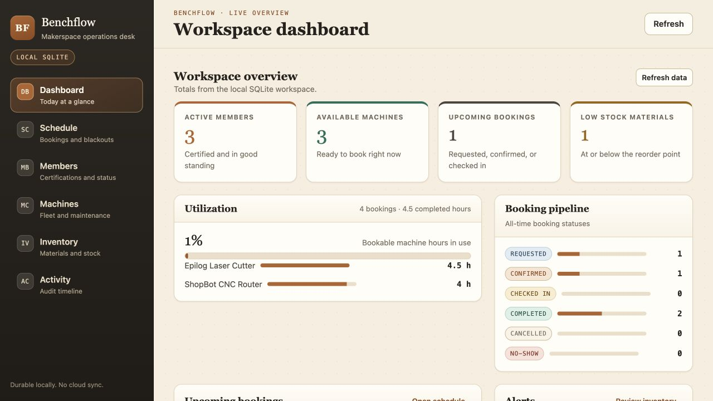

# Hi, I'm Kazi

I'm **Kazi Rezoanur Rahman**, a software engineer building full-stack products and event-driven systems. I turn complicated workflows into clear interfaces, dependable APIs, and tools people can understand.

**[LinkedIn](https://www.linkedin.com/in/kazi-rezoanur-rahman/)** · **[Explore my repositories](https://github.com/RezoanurRahman?tab=repositories)**

## Featured work

<table>
<tr>
<td width="50%" valign="top">

### Wallwise · Gallery operations

Plan exhibitions, organize artworks, and keep the next installation on track.

**React · Elysia · TypeScript · SQLite**

Conflict-aware artwork placement, explicit exhibition lifecycles, and an append-only activity trail. Shared contracts connect browser and API.

**[Code & setup →](https://github.com/RezoanurRahman/wallwise#quick-start)**

</td>
<td width="50%" valign="top">

### Benchflow · Makerspace operations

Coordinate certified members, machine bookings, maintenance, and materials.

**Preact · Hapi · TypeScript · SQLite**

Booking checks cover certifications, schedule conflicts, and maintenance. Material reservations and stock settlement happen atomically.

**[Code & setup →](https://github.com/RezoanurRahman/benchflow#quick-start)**

</td>
</tr>
</table>

*Real screenshots from local runs with each project's seeded demo data.*

## More to explore

| Project | The engineering challenge | Stack |
| :--- | :--- | :--- |
| **[Inkline](https://github.com/RezoanurRahman/inkline)** | Print-studio production: conflict-aware press scheduling and transactional material reservations. | Vue · Koa · SQLite |
| **[Nightward](https://github.com/RezoanurRahman/nightward)** | Astronomy-club planning: target assignments, observing logs, and computed insights. | SolidJS · Express · SQLite |
| **[Caregrid](https://github.com/RezoanurRahman/caregrid)** | Clinic coordination demo: appointment conflicts, session capacity, and auditable follow-ups. | Lit · Fastify · SQLite |
| **[Event-Agent-Sim](https://github.com/RezoanurRahman/event-agent-sim)** | Trace a submission through an event pipeline and stream results back to the dashboard. | React · Kafka · PostgreSQL · SSE |

Earlier builds & more experiments

- **[Shelfmark](https://github.com/RezoanurRahman/shelfmark)** — a personal reading log with Vue and Express.
- **[GearLoop](https://github.com/RezoanurRahman/gearloop)** — a shared equipment checkout board with React and Hono.
- **[Tail Spend Guardian](https://github.com/RezoanurRahman/tail-spend-guardian)** — a procurement audit dashboard with React, Express, Prisma, and PostgreSQL.
- **[Browse the full collection →](https://github.com/RezoanurRahman?tab=repositories&type=source)**

## My toolkit

| Product | Backend & data | Quality & delivery |
| :--- | :--- | :--- |
| TypeScript · React · Vue · Vite | Node.js · REST APIs · SSE | Vitest · Playwright |
| Accessible interfaces | PostgreSQL · SQLite · Prisma · Kafka | GitHub Actions · Docker |

## Let's connect

Interested in full-stack products, backend systems, and developer tooling. **[Get in touch on LinkedIn →](https://www.linkedin.com/in/kazi-rezoanur-rahman/)**
